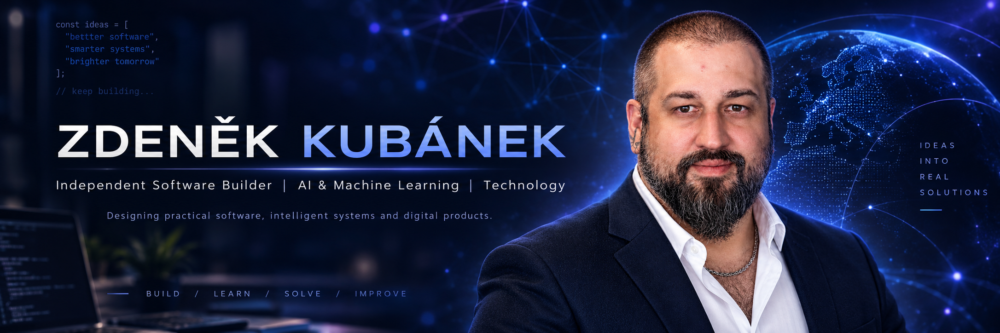

**[💼 LinkedIn](https://www.linkedin.com/in/zdeněk-kubánek-2a0716265/)** &nbsp; | &nbsp;
**[𝕏 X / Twitter](https://x.com/ZdenekKubanek84)** &nbsp; | &nbsp;
**[⚙️ MARKCORE Technologies](https://www.markcore.cz)** &nbsp; | &nbsp;
**[✒️ GENESIS Tattoo](https://www.genesistattoo.cz)**

---

## 👋 About Me

I'm an independent software builder and entrepreneur based in the Czech Republic.

I design and develop software connecting **artificial intelligence, practical automation, business operations and real-world technology**.

My background combines over two decades of creative work and business experience with industrial technology and the development of my own software systems.

My primary interests include artificial intelligence, machine learning, computer vision, software architecture, desktop and mobile applications, and industrial automation.

**My goal is simple: build useful, reliable technology that works beyond demonstrations.**

---

## 🚀 Featured Software Projects

Independent software projects at different stages of development, spanning AI, mobile applications, software infrastructure and financial technology.

<table>
<tr>
<td width="50%" valign="top">

<h3>🧠 LAUNIRA AI Studio</h3>

<strong>AI & Machine Learning Platform</strong>

A desktop platform for working with datasets, machine learning models and multimodal artificial intelligence.

<strong>Key areas:</strong>

<ul>
<li>Computer vision and annotation</li>
<li>Audio and video processing</li>
<li>Dataset management</li>
<li>Local AI model workflows</li>
<li>Model evaluation and experimentation</li>
</ul>

</td>
<td width="50%" valign="top">

<h3>🏗️ Universal Core</h3>

<strong>Software Architecture & Infrastructure</strong>

A modular software foundation for reusable capabilities, reliable development and complex software systems.

<strong>Key areas:</strong>

<ul>
<li>Modular architecture</li>
<li>Reusable components</li>
<li>Automated verification</li>
<li>Testing and reliability</li>
<li>Development infrastructure</li>
</ul>

</td>
</tr>
<tr>
<td width="50%" valign="top">

<h3>📱 GENESIS Ecosystem</h3>

<strong>Mobile Apps & Business Technology</strong>

An interconnected ecosystem of mobile applications and administrative tools designed around real studio operations.

<strong>Key areas:</strong>

<ul>
<li>Mobile applications</li>
<li>Bookings and appointments</li>
<li>Business administration</li>
<li>Digital consent and documents</li>
<li>Secure communication</li>
<li>Payments and workflows</li>
</ul>

</td>
<td width="50%" valign="top">

<h3>📊 LAUNIRA Finance Core</h3>

<strong>Personal Finance & Financial Intelligence</strong>

A personal finance application designed to organize financial information and support better everyday decisions.

<strong>Key areas:</strong>

<ul>
<li>Transactions and budgeting</li>
<li>Receipts and OCR processing</li>
<li>Financial data organization</li>
<li>Import and backup workflows</li>
<li>Analysis and scenario planning</li>
</ul>

</td>
</tr>
</table>

---

## ⚙️ Industrial Technology – MARKCORE

**Precision Manufacturing · Laser Technology · Automation**

Alongside software development, I work with industrial technologies through MARKCORE Technologies.

This provides a direct connection between software engineering and practical industrial processes.

**Areas of activity:**

- Fiber and CO₂ laser marking
- Industrial identification and precision marking
- Manufacturing process development
- Process automation
- Machine vision and inspection concepts
- Practical industrial technology integration

🌐 **[Explore MARKCORE Technologies →](https://www.markcore.cz)**

---

## 🛠️ Technology Stack

The programming languages, frameworks and tools used across my software projects.

### Programming Languages

<table>
<tr>
<td align="center" width="33%">

 
<strong>Python</strong>
</td>
<td align="center" width="33%">

 
<strong>Dart</strong>
</td>
<td align="center" width="33%">

 
<strong>TypeScript</strong>
</td>
</tr>
</table>

### Frameworks & Application Development

<table>
<tr>
<td align="center" width="50%">

 
<strong>Flutter</strong>
</td>
<td align="center" width="50%">

 
<strong>Next.js</strong>
</td>
</tr>
</table>

### Development Tools & Databases

<table>
<tr>
<td align="center" width="25%">

 
<strong>Git</strong>
</td>
<td align="center" width="25%">

 
<strong>GitHub</strong>
</td>
<td align="center" width="25%">

 
<strong>SQLite</strong>
</td>
<td align="center" width="25%">

 
<strong>VS Code</strong>
</td>
</tr>
</table>

### AI, Engineering & Technical Interests

| Field | Focus |
|---|---|
| 🧠 **Artificial Intelligence** | Local AI systems, model workflows, practical applications |
| 🔬 **Machine Learning** | Model experimentation, evaluation and datasets |
| 👁️ **Computer Vision** | Image analysis, annotation and visual inspection |
| 🎧 **Multimodal Processing** | Audio, video and image workflows |
| 🏗️ **Software Architecture** | Reusable components, modular systems and testing |
| ⚙️ **Industrial Technology** | Laser marking, automation and machine vision |

---

## 💡 Engineering Philosophy

My approach to software development is shaped by practical experience, continuous experimentation and an interest in how complex systems work.

**01 · Build for real use**

Software should solve actual problems, not exist only as a technical demonstration.

**02 · Verify what works**

Testing, measurement, reliability and repeatability are essential to meaningful progress.

**03 · Learn through building**

Experimentation, development and continuous improvement are central to my work.

**04 · Connect different disciplines**

Some of the most valuable ideas emerge where software meets manufacturing, creative work and everyday business operations.

---

## 🔐 Development & Repositories

Many of my projects are developed in private repositories.

This GitHub profile serves as a public introduction to my technical work, independent development activities and areas of interest.

Selected project information may be shared publicly while proprietary source code remains private.

---

## 🌍 Connect & Collaborate

I'm interested in exchanging ideas and connecting with people working in applied AI, software engineering, intelligent systems and practical technology.

**Professional network**

[LinkedIn – Zdeněk Kubánek](https://www.linkedin.com/in/zdeněk-kubánek-2a0716265/)

**Technical discussions & updates**

[X – @ZdenekKubanek84](https://x.com/ZdenekKubanek84)

**Industrial technology**

[MARKCORE Technologies](https://www.markcore.cz)

**Creative work & business technology**

[GENESIS Tattoo & Piercing](https://www.genesistattoo.cz)

---

### BUILD · LEARN · VERIFY · IMPROVE

*Independent development. Practical technology. Continuous progress.*

**Zdeněk Kubánek · Czech Republic**

